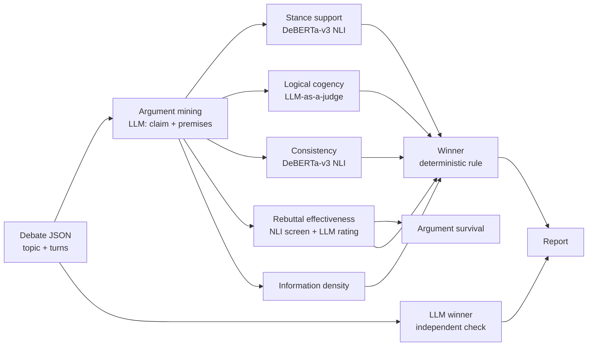

# The Debate Arena for Large Language Models: Logic Track (Debate Judge)

An automatic **judge for debates between large language models**. Two LLMs debate a topic; the judge scores every argument (does it support its side? is the reasoning sound? does the speaker contradict themselves?), checks which arguments were rebutted, and picks a winner with a transparent, explainable rule.

Built as the logic track of the *Debate Arena for Large Language Models*, a Master's research project at the Webis group, Bauhaus-Universität Weimar (Summer 2026, 12 ECTS, grade 1.5).

## Project details

| | |
|---|---|
| **Project** | The Debate Arena for Large Language Models (logic track: the debate judge) |
| **University** | Bauhaus-Universität Weimar, Faculty of Media, [Webis group](https://webis.de) |
| **Degree programme** | M.Sc. Computer Science for Digital Media |
| **Module** | Research Project I |
| **Semester** | Summer Semester 2026 (April – September 2026, submitted 30 September 2026) |
| **Supervisors** | Maximilian Heinrich, Midhun Kanadan |
| **Credits** | 12 ECTS |
| **Grade** | **1.5** (German scale: 1.0 = best, 4.0 = pass) |
| **Team** | 5 students in the whole Debate Arena project; logic track: Pavan Sai Kushana and Immanuvel Joseph |
| **Author of this repository** | Pavan Sai Kushana ([LinkedIn](https://www.linkedin.com/in/pavankushana) · [GitHub](https://github.com/PavanKushana)) |

**Project description.** The Debate Arena lets two LLMs debate a motion over several rounds while an automatic judge evaluates the debate. The project combined debate generation, argument retrieval, emotion analysis and judging; this repository contains the **logic track**, which judges the *quality of the reasoning*: whether each argument supports its side, whether its premises justify its claim, whether speakers stay consistent, which arguments were rebutted, and who won and why.

---

## Why

LLM debates are a way to compare models on reasoning, not just on facts. But judging a debate by hand is slow, and asking another LLM "who won?" gives one opaque number. This judge breaks the decision into **separate, research-based metrics** that can each be tested against human annotations, so you can see *why* a speaker won and *where* the judge itself fails.

## How it works



| Level | Metric | Method |
|---|---|---|
| Turn | **Stance support**: does the turn argue for the speaker's side? | NLI entailment of the claim against the speaker's side hypothesis |
| Turn | **Logical cogency**: acceptability, relevance, sufficiency (1–3) | One LLM call following Wachsmuth et al. (2017); a quoted rationale is generated before each score |
| Turn | **Consistency**: does the speaker contradict their earlier claims? | 1 − max P(contradiction) against each earlier claim |
| Debate | **Rebuttal effectiveness**: which sentence attacks which earlier point, and how well | NLI contradiction screen over all sentence/target pairs, then an LLM rates each attack 1–3 |
| Debate | **Argument survival**: which arguments are still standing at the end | Bookkeeping over the rebuttal results (no extra model call) |
| Debate | **Information density**: how much new, on-topic content each speaker adds | Novelty against the speaker's own earlier points |
| Debate | **Winner** | Two-level rule: cogency + rebuttal first, stance + consistency as support; plus an independent one-shot LLM verdict for comparison |

Diagrams for every metric are in [`judge_service_v2/metric_flow_diagrams/`](judge_service_v2/metric_flow_diagrams/).

## My role

I developed the logic track together with **Immanuvel Joseph** (pair development, so most commits came from one laptop).

- **Owned the turn-level metrics**: stance support, logical cogency and consistency. Also worked on all debate-level metrics and the winner rule.
- **Built the first prototype** ([`prototype/`](prototype/)): a FastAPI service where an LLM extracts claims and premises and compares them with reference arguments.
- **Tested every version of the judge** against human annotations and wrote the test harness ([`testing/`](testing/)).
- **Annotated debates** as ground truth ([`annotations/`](annotations/)) and helped revise the annotation guideline.

## Results from my testing

Final judge, 3 turn-level metrics, **5 annotated debates × 6 turns = 30 turns**, every output reviewed by hand ([full summary](testing/turn_level_metrics_summary.md)):

| Metric | Result | What it showed |
|---|---|---|
| Logical cogency | **gemma4:26b 19/30 correct** vs. qwen2.5:7b 12/30 | The smaller model gave the same scores to every turn and often no reasons; model choice matters |
| Consistency | 18/20 correct | Looks strong, but it missed the one real change of position, so it needs harder test cases |
| Stance support | 17/30 wrong | NLI rewards *repeating* the side, not *arguing* for it; the method needs to change |

Testing the earlier version by hand (7 endpoints, 17 designed test cases, 3 full debates) led to the redesign from ~9 hand-weighted signals to these separate metrics, and moved cogency from NLI to an LLM judgement.

**Biggest lesson:** a metric can pass easy test cases and still fail on real debates. Test both, and compare with human annotations.

---

## Try it yourself

You don't need the university cluster. Pick the level that suits you.

### Level 1: just read (no installation)

- [`judge_service_v2/metric_flow_diagrams/`](judge_service_v2/metric_flow_diagrams/): how each metric works
- [`testing/`](testing/): test inputs, raw outputs and the reviewed results
- [`docs/final_presentation_pavan.pdf`](docs/final_presentation_pavan.pdf): my final presentation of the project

### Level 2: run it on your laptop without an LLM

Two metrics, **consistency** and **stance support** (when you pass the side hypothesis), only need a small NLI model that downloads automatically (~700 MB, runs on CPU).

**You need:** Python 3.11+ and about 3 GB of free disk space.

```bash
git clone https://github.com/PavanKushana/debate-arena-llm-judge.git
cd debate-arena-llm-judge
python -m venv .venv
# Windows: .venv\Scripts\activate      macOS/Linux: source .venv/bin/activate
pip install -r judge_service_v2/requirements.txt
uvicorn judge_service_v2.api:app --port 8500
```

> **Windows tip:** clone into a short path such as `C:\code\debate-arena-llm-judge`. PyTorch has very long file paths, and installing it inside a deep folder can fail unless Windows long-path support is enabled.

Then open **http://localhost:8500/** for the built-in tester page, or **http://localhost:8500/docs** for the interactive API docs. Or try it from the command line:

```bash
# Consistency: does the new claim contradict what the speaker said before?
curl -X POST http://localhost:8500/score/consistency \
  -H "Content-Type: application/json" \
  -d '{"claim": "Remote work hurts productivity.",
       "prior_claims": ["Working from home makes employees more productive."]}'

# Stance support: does this claim argue for the PRO side?
curl -X POST http://localhost:8500/score/stance-support \
  -H "Content-Type: application/json" \
  -d '{"topic": "Working from home is better than working in an office",
       "turn": "Without a commute, people gain time and focus better at home.",
       "claim": "Working from home improves focus.",
       "stance": "PRO",
       "hypothesis": "Working from home is better than working in an office."}'
```

The first call should report a low consistency score (the speaker contradicts themselves); the second should report how strongly the claim supports the PRO side.

### Level 3: the full judge (free, local LLM)

The LLM-based parts (argument mining, logical cogency, rebuttal rating, winner reasoning) use **[Ollama](https://ollama.com)**, a free program that runs open models on your own computer.

1. Install Ollama from [ollama.com](https://ollama.com).
2. Download a model (qwen2.5:7b needs about 5 GB of disk space and 8 GB of RAM):
   ```bash
   ollama pull qwen2.5:7b
   ```
3. Start the judge as in Level 2. It talks to Ollama at `http://localhost:11434` by default.
4. Open **http://localhost:8500/** and score a whole debate, or call `POST /score/debate`.

For better cogency scores use a larger model, e.g. `ollama pull gemma4:26b` and set `OLLAMA_MODEL=gemma4:26b` (it needs a strong machine). You can also replay my tests:

```bash
python testing/run_turn_metrics.py --api http://localhost:8500
```

### Settings

All settings are environment variables (or a `.env` file in the repository root):

| Variable | Default | Purpose |
|---|---|---|
| `OLLAMA_HOST` | `http://localhost:11434` | Where Ollama runs |
| `OLLAMA_MODEL` | `qwen2.5:7b` | Model for the LLM-based metrics |
| `ES_API` | *(empty)* | Optional reference-argument search for the Delta/Votes extras; without it they report "not applicable" |

---

## Repository layout

```
judge_service_v2/        the final judge (FastAPI)
  turn_level_scoring/      stance support, logical cogency, consistency (+ delta/votes extra)
  debate_level_scoring/    rebuttal effectiveness, argument survival, information density, winner
  prompts/                 system prompts for every LLM call
  utils/                   argument mining, topic hypotheses, config, logging
  validation/              agreement checks against the Dagstuhl argument-quality corpus
  metric_flow_diagrams/    one diagram per metric
  tester.html              browser UI served at http://localhost:8500/
prototype/               my first FastAPI + Streamlit prototype (judge v0)
testing/                 test harness, inputs, raw outputs and reviewed results
annotations/             my human annotations of three debates (ground truth)
docs/                    final presentation
```

## Credits

- Logic track: **Pavan Sai Kushana** and **Immanuvel Joseph** (co-developers).
- Project team and supervision: Webis group, Bauhaus-Universität Weimar, *Debate Arena for Large Language Models* (Summer 2026). Published with the supervisor's permission.
- NLI model: [MoritzLaurer/DeBERTa-v3-base-mnli-fever-anli](https://huggingface.co/MoritzLaurer/DeBERTa-v3-base-mnli-fever-anli).
- Cogency framework: Wachsmuth et al., *Computational Argumentation Quality Assessment in Natural Language*, EACL 2017.
